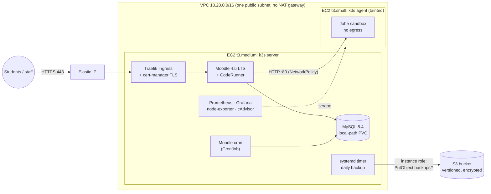

# moodle-k3s-aws

[](https://github.com/Kavinnandha/moodle-k3s-aws/actions/workflows/terraform.yml)
[](https://github.com/Kavinnandha/moodle-k3s-aws/actions/workflows/manifests.yml)
[](https://github.com/Kavinnandha/moodle-k3s-aws/actions/workflows/image.yml)

A small, reproducible AWS rebuild of the Moodle LMS platform I ran on bare metal
for my college. Terraform creates the AWS side (VPC, two EC2 nodes running k3s,
security groups, an S3 backup bucket and least-privilege IAM). Plain Kubernetes
manifests run Moodle + CodeRunner, MySQL, an isolated Jobe sandbox,
TLS Ingress and Prometheus/Grafana on top.

The whole thing comes up with `terraform apply` + one deploy script, and goes
away with `terraform destroy`. An evening of testing costs well under a dollar.

> **What this is and isn't.** The production system was one large physical
> server and handled 2,500+ concurrent users at peak. This repo is a *scaled-down
> lab* of the same architecture, sized for a demo with a handful of users.
> The load figure belongs to the bare-metal system, not to this AWS build.

---

## Architecture



**Request path:** browser → Elastic IP → Traefik (TLS from Let's Encrypt via
cert-manager) → Moodle pod → MySQL. When a student submits code in a CodeRunner
question, Moodle calls the in-cluster `jobe` Service. Jobe compiles and runs
the code on a **separate node**, and returns the result.

### How it maps to the bare-metal original

| Bare-metal (campus) | This AWS lab | Why the change |
|---|---|---|
| Dual Xeon Gold 6430, 256 GB ECC RAM | `t3.medium` (2 vCPU / 4 GB) + `t3.small` (2 vCPU / 2 GB) | Sized for a demo, not 2,500 users. Instance types are variables. |
| Hardware RAID | Encrypted gp3 EBS + daily dumps to versioned S3 | EBS replicates within an AZ. The S3 copy covers losing the volume. |
| Dual 10GbE | VPC, Internet Gateway, security groups | Cloud networking replaces the physical NICs and switch. |
| k3s cluster | k3s `v1.37.2+k3s1`, installed by cloud-init user-data | Same distro. The install is now code, pinned to a version. |
| Moodle LMS | Moodle 4.5 LTS image built from `docker/moodle` | Code is baked into the image (read-only). Only `moodledata` is writable. |
| CodeRunner + Jobe | Same, with Jobe on its **own tainted node**, deny-all egress | Untrusted student code never shares a kernel with the web tier or DB. |
| Prometheus + Grafana | `kube-prometheus-stack` (Helm, pinned) | One chart instead of hand-installed components. |
| cAdvisor | Scraped from the kubelet (k3s embeds cAdvisor) | No separate DaemonSet needed. |
| Node Exporter | `prometheus-node-exporter` DaemonSet on both nodes | Tolerates the Jobe taint, so both nodes report. |
| — | Terraform + GitHub Actions (`fmt`, `validate`, `tflint`, kubeconform, shellcheck) | Everything is reviewable and rebuildable. |

---

## Repository layout

```
terraform/            AWS infrastructure
  network.tf          VPC, public subnet, IGW, route table; default SG emptied
  security_groups.tf  server + jobe SGs (k3s port matrix, no SSH)
  compute.tf          Ubuntu 24.04 AMI, Elastic IP, server + jobe instances (IMDSv2, hop limit 1)
  iam.tf              per-node instance roles, least privilege
  s3.tf               backup bucket: private, SSE, versioned, TLS-only, lifecycle expiry
  ssm.tf              k3s join token in SSM Parameter Store (SecureString)
  budget.tf           optional AWS Budget email alert
  templates/          cloud-init user-data for server and agent
k8s/
  namespaces.yaml     moodle / jobe / monitoring, with Pod Security levels
  moodle/             MySQL StatefulSet, Moodle Deployment, install Job, cron CronJob,
                      Ingress (+HTTPS redirect), NetworkPolicies
  jobe/               Jobe Deployment + Service + deny-all NetworkPolicies
  cert-manager/       Let's Encrypt staging + prod ClusterIssuers
  monitoring/         kube-prometheus-stack values trimmed for a 4 GB node
docker/moodle/        Moodle 4.5 + CodeRunner image (Dockerfile, config.php, install script)
scripts/
  fetch-kubeconfig.sh pull the kubeconfig over SSM (no SSH)
  deploy.sh           secrets, cert-manager, MySQL, Moodle, Jobe, monitoring, in order
.github/workflows/    terraform lint, manifest/shell lint, image build -> GHCR
```

---

## Cost

Everything is on-demand Linux pricing in **us-east-1** (Nov 2026). Mumbai
(`ap-south-1`, the default region here) is in the same range. Check the
[AWS Pricing Calculator](https://calculator.aws/) for your region before you
apply.

| Resource | Rate | Per hour |
|---|---|---|
| EC2 `t3.medium` (server) | $0.0416/h | $0.0416 |
| EC2 `t3.small` (Jobe) | $0.0208/h | $0.0208 |
| Public IPv4 × 2 (EIP + Jobe node) | $0.005/h each | $0.0100 |
| EBS gp3, 35 GB | $0.08/GB-month | ~$0.0038 |
| S3, SSM Parameter (standard), IAM, VPC, SG, Budgets | free tier / free | ~$0 |
| **Total** | | **≈ $0.077/h** |

* **One 4-hour session ≈ $0.30.** Destroy it when you're done.
* **Left running for a whole month ≈ $56.** Don't. Set `budget_alert_email` so
  AWS emails you at 50% of a $10 budget.
* **Cheaper:** `enable_jobe_node = false` runs everything on the server node
  (≈ $0.05/h). You lose the separate sandbox node, but Jobe's NetworkPolicy
  isolation still applies.
* **No NAT gateway, no load balancer.** A NAT gateway alone is ~$32/month, and
  an ALB ~$16/month before traffic. Traefik binds 80/443 on the server node
  directly.
* **CPU credits** are set to `standard`. T3 defaults to `unlimited`, which can
  quietly bill for sustained CPU.

**Free tier, honestly:** AWS accounts created after 15 July 2025 get a Free
Plan with up to $200 in credits. That covers this lab many times over. Older
accounts only get the 12-month 750 h of `t2.micro`/`t3.micro` (1 GB RAM). Moodle
+ MySQL + Prometheus can't run in 1 GB, so on a legacy account this costs
the rates above. Check which instance types your account treats as free tier
in the EC2 console for your region.

---

## Deploy

### Prerequisites

* An AWS account and an IAM user/role for Terraform (not the root user), with
  AWS CLI v2 configured (`aws sts get-caller-identity` works)
* Terraform ≥ 1.6, kubectl, Helm 3, `envsubst` and `openssl`
  (Linux/macOS, WSL, or Git Bash on Windows)
* [Session Manager plugin](https://docs.aws.amazon.com/systems-manager/latest/userguide/session-manager-working-with-install-plugin.html)
  for the AWS CLI (only needed for interactive shells)

### 1. Publish the Moodle image

Push this repo to GitHub. The `moodle-image` workflow builds `docker/moodle` and
pushes `ghcr.io/<you>/moodle-coderunner:4.5`. GHCR packages start out
**private**: open the package settings on GitHub and set visibility to
**Public**, or k3s can't pull it.

### 2. Create the infrastructure

```bash
cd terraform
cp terraform.tfvars.example terraform.tfvars   # set admin_cidr to your IP/32
terraform init
terraform plan -out tf.plan
terraform apply tf.plan
```

First boot takes about 3-5 minutes: cloud-init installs the AWS CLI, reads the
join token from SSM and installs k3s.

### 3. Get the kubeconfig (over SSM, no SSH)

```bash
$(terraform output -raw fetch_kubeconfig)
export KUBECONFIG=$PWD/kubeconfig
kubectl get nodes -o wide        # expect 2 nodes: server + jobe
```

### 4. Deploy the workloads

```bash
cd ..
MOODLE_HOST=$(terraform -chdir=terraform output -raw moodle_host) \
ACME_EMAIL=you@example.com \
./scripts/deploy.sh
```

`deploy.sh` generates the Secrets (they are never in git) and installs
cert-manager and the issuers. It then starts MySQL and runs the Moodle
install Job **before** the Ingress exists, so the web installer is never public.
After that it starts Moodle, cron, Jobe and kube-prometheus-stack. It
prints the admin-password and Grafana commands at the end.

**About TLS:** `MOODLE_HOST` defaults to `moodle.<EIP>.sslip.io`, a wildcard DNS
name that needs no domain purchase. sslip.io is *not* on the Public Suffix
List, so every sslip.io user shares one Let's Encrypt rate limit. That's
why the default issuer is **`letsencrypt-staging`**: it proves the whole ACME
flow works, but browsers will warn about the certificate. For a trusted
certificate, point an A record on a domain you own at the EIP, then run:

```bash
MOODLE_HOST=lms.yourdomain.tld CLUSTER_ISSUER=letsencrypt-prod ACME_EMAIL=you@example.com ./scripts/deploy.sh
```

### 5. Check it works

```bash
kubectl get pods -A -o wide          # jobe-* should be on the jobe node, everything else on the server
kubectl -n moodle get certificate    # READY=True
kubectl -n monitoring port-forward svc/kps-grafana 3000:80   # dashboards: Node Exporter, Kubernetes / Compute Resources
```

In Moodle, create a CodeRunner question (e.g. Python 3, "print the sum of 0..9").
Then use **Preview**: a correct answer coming back means the
Moodle → Jobe path and its NetworkPolicy are working.

Trigger a backup and look at it:

```bash
aws ssm start-session --target $(terraform -chdir=terraform output -raw server_instance_id)
sudo systemctl start moodle-backup.service && sudo journalctl -u moodle-backup -n 20
# back on your machine:
aws s3 ls s3://$(terraform -chdir=terraform output -raw backup_bucket)/backups/ --recursive
```

---

## Security design

* **No SSH, no port 22.** Shell access goes through SSM Session Manager, which is
  authenticated and logged by IAM.
* **API server** (6443) is reachable only from `admin_cidr` (validated, `0.0.0.0/0`
  rejected) and from the agent node's security group.
* **Jobe node accepts no internet traffic.** Its SG only allows VXLAN, kubelet and
  node-exporter from the server SG.
* **Least-privilege IAM, per node.** The server can `PutObject`/`GetObject`/`ListBucket`
  under `backups/` only. It has **no delete**, so a compromised node can't wipe
  backups; the lifecycle rule expires them. The Jobe node has no S3 access at all.
* **IMDSv2 required, hop limit 1.** Pods, including student code in Jobe,
  can't reach the instance metadata service, so they can't steal the node's
  AWS credentials.
* **k3s join token** is in SSM Parameter Store (SecureString), not in user-data.
* **NetworkPolicies** (enforced by k3s's built-in controller): default-deny
  ingress in `moodle`; MySQL only from labelled clients; Jobe default-deny
  **ingress and egress**, reachable only from Moodle pods.
* **Moodle SSRF hardening.** `curlsecurityblockedhosts` blocks the VPC, pod CIDR
  and metadata endpoint, and allows only the Service CIDR, where Jobe lives.
* **Pod Security Admission** `baseline` enforced on `moodle` and `jobe`. Service
  account tokens are not mounted in any app pod.
* **S3:** public access blocked, SSE-S3, versioning, TLS-only bucket policy.
* **k3s** runs with `secrets-encryption` (Secrets encrypted at rest in the datastore).
* **Encrypted EBS** root volumes on both nodes.

---

## Restore from backup

```bash
B=$(terraform -chdir=terraform output -raw backup_bucket)
STAMP=20261117T203000Z   # pick one from: aws s3 ls s3://$B/backups/

# database
aws s3 cp s3://$B/backups/$STAMP/moodle-db.sql.gz - | gunzip | \
  kubectl -n moodle exec -i mysql-0 -c mysql -- sh -c 'MYSQL_PWD="$MYSQL_ROOT_PASSWORD" mysql -uroot'

# moodledata
aws s3 cp s3://$B/backups/$STAMP/moodledata.tar.gz - | \
  kubectl -n moodle exec -i deploy/moodle -c moodle -- tar -C /var/www -xzf -
kubectl -n moodle rollout restart deployment/moodle
```

---

## Tear down

```bash
cd terraform
terraform destroy
```

That deletes everything this project created: both instances and their EBS
volumes, the Elastic IP, VPC, security groups, IAM roles, SSM parameter and
budget. It also empties and deletes the backup bucket, because
`backup_bucket_force_destroy = true` by default. **Copy any backup you want to keep first.**

Nothing is left behind outside Terraform. The cluster creates no cloud
resources on its own: there is no AWS load balancer controller and no EBS CSI
driver, so Traefik binds the node's ports and PVs live on the root volume.
To double-check that nothing is still billing:

```bash
aws ec2 describe-instances --filters Name=tag:Project,Values=moodle-k3s Name=instance-state-name,Values=running,stopped --query 'Reservations[].Instances[].InstanceId'
aws ec2 describe-addresses --filters Name=tag:Project,Values=moodle-k3s
aws s3 ls | grep moodle-k3s-backups
```

All three should print nothing (or `[]`). Delete `terraform/kubeconfig`,
`kubeconfig` and `terraform.tfstate*` locally if you're done for good. The
state file contains the k3s token.

---

## Trade-offs (deliberate, for cost)

| Lab choice | What production would use |
|---|---|
| Single AZ, single k3s server | 3 servers with embedded etcd across AZs, or EKS |
| Public subnet, no NAT | Private subnets + NAT gateway + ALB/NLB in front |
| `local-path` volumes on the root disk | EBS CSI driver for MySQL, EFS (ReadWriteMany) for `moodledata` |
| One Moodle replica (RWO `moodledata`) | EFS + several replicas + HPA, Redis for sessions/MUC cache |
| MySQL in-cluster | Amazon RDS for MySQL (Multi-AZ, automated snapshots) |
| Local Terraform state | S3 backend with native lockfile |
| Alertmanager disabled | Alertmanager → email/Slack/PagerDuty |
| cluster-admin kubeconfig via SSM | OIDC login / scoped ServiceAccounts |

## Next steps

- [ ] GitOps: Argo CD or Flux syncing `k8s/` instead of `deploy.sh`
- [ ] GitHub Actions → AWS via OIDC for `terraform plan` on PRs (no long-lived keys)
- [ ] `mysqld-exporter` + a Moodle/MySQL Grafana dashboard
- [ ] Load test with k6 against a CodeRunner quiz to find this build's limits

## Validation status

| Check | Where | Status |
|---|---|---|
| `terraform fmt -check`, `terraform validate`, `tflint` (AWS ruleset) | CI + local | passing |
| kubeconform on rendered manifests, shellcheck on scripts | CI + local | passing |
| Moodle image builds; installs Moodle 4.5 + CodeRunner on MySQL 8.4; re-run takes the upgrade path; cron runs; login page serves | local Docker | passing |
| Moodle → Jobe through Moodle's curl SSRF filter on a 10.43.0.0/16 network; Python run returns correct output; pod CIDR and metadata IP blocked | local Docker | passing |
| Full `terraform apply` + `deploy.sh` on AWS | AWS | _not yet run; update after first apply_ |
